# Component diagrams

The same hierarchy as [COMPONENTS.md](./COMPONENTS.md), drawn as diagrams. GitHub renders them; in VS Code, install the "Markdown Preview Mermaid Support" extension and open the Markdown preview.

**Colours**

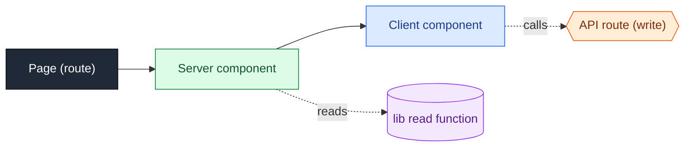

Solid arrows: "renders". Dotted arrows: reads data / calls the API. Dashed boxes are `<Suspense>` boundaries.

---

## App overview

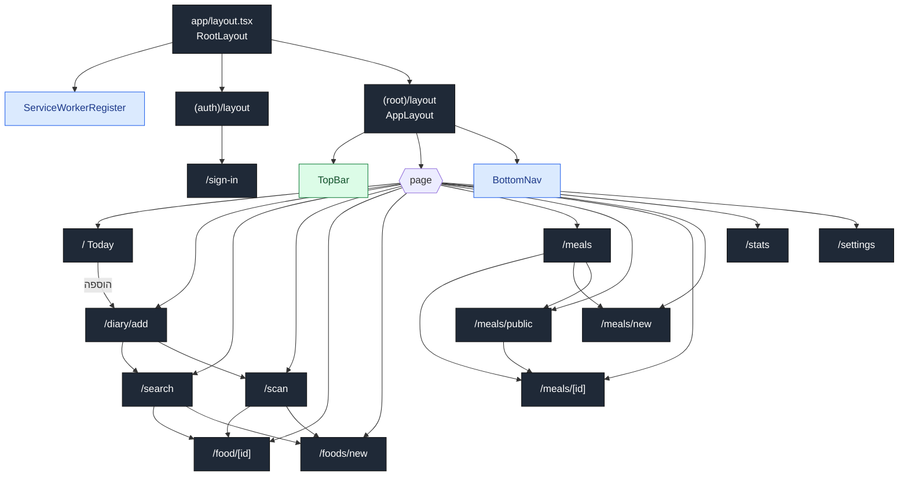

## App shell

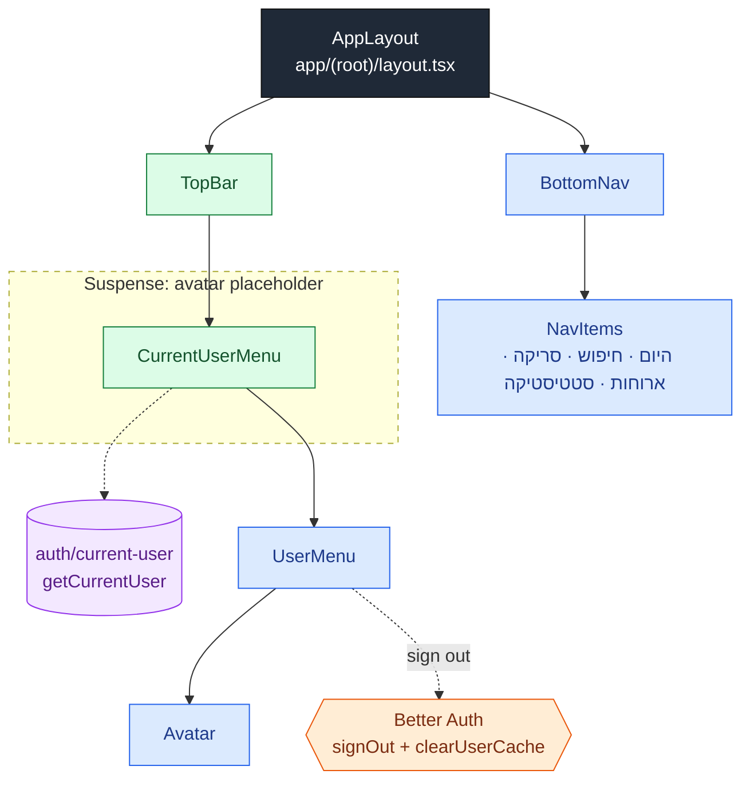

## 1. Sign-in

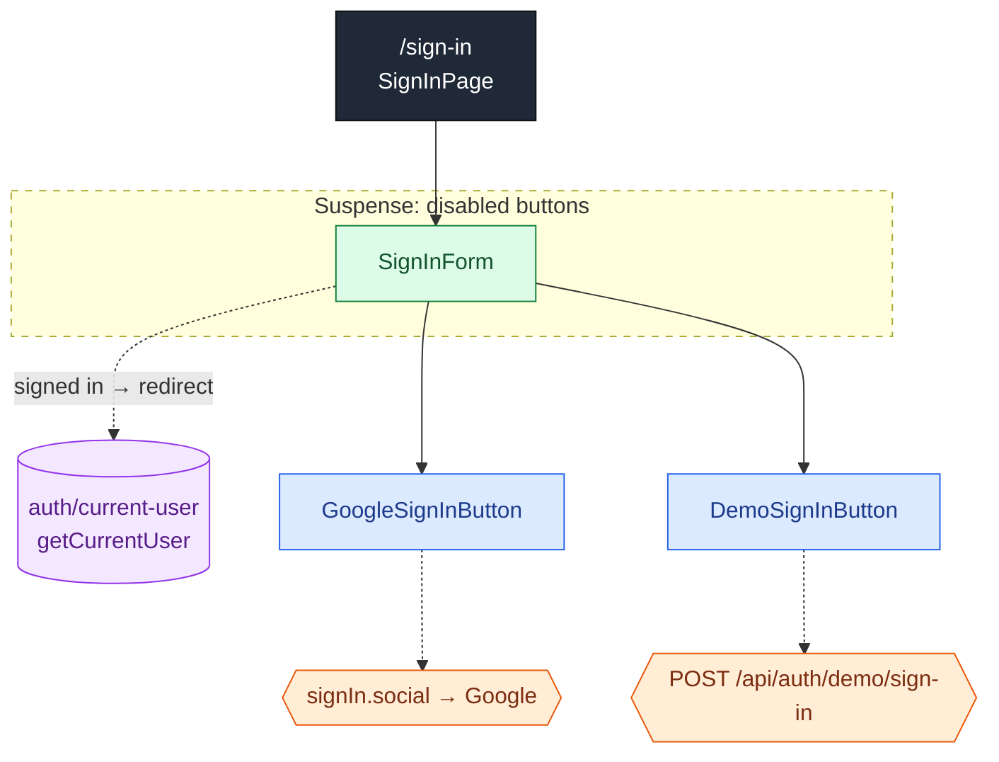

## 2. Today (diary)

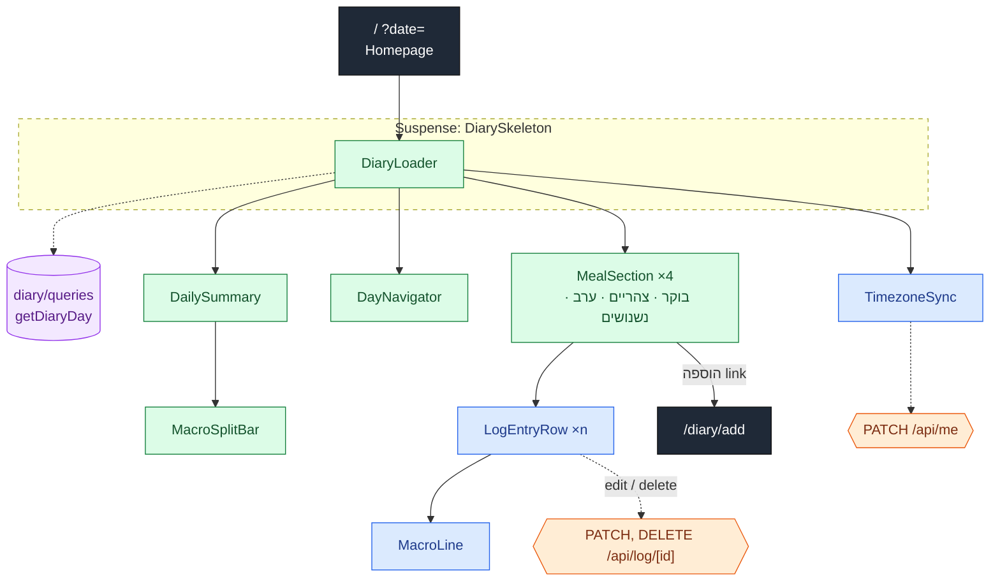

### 2a. Add to a diary section

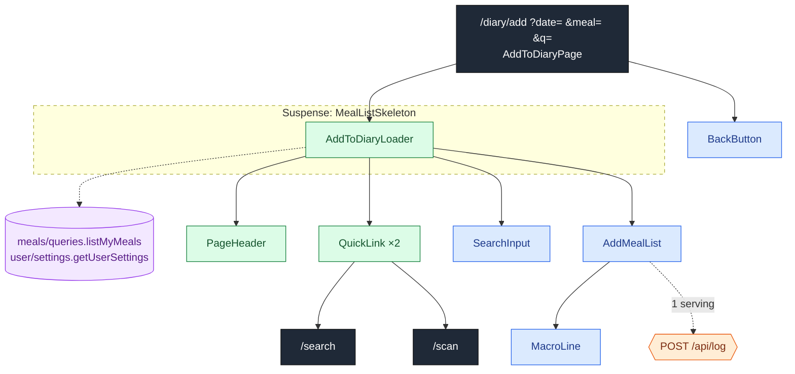

## 3. Food search

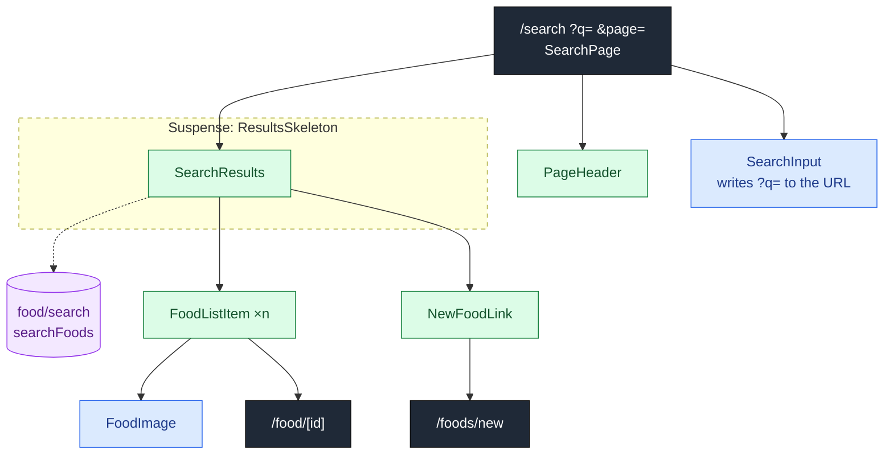

## 4. Scan a barcode

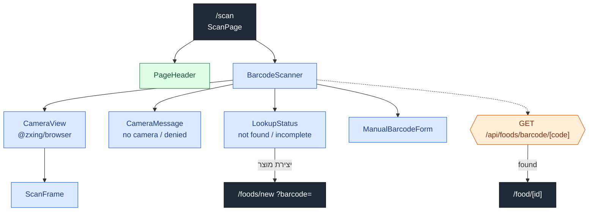

## 5. Food page

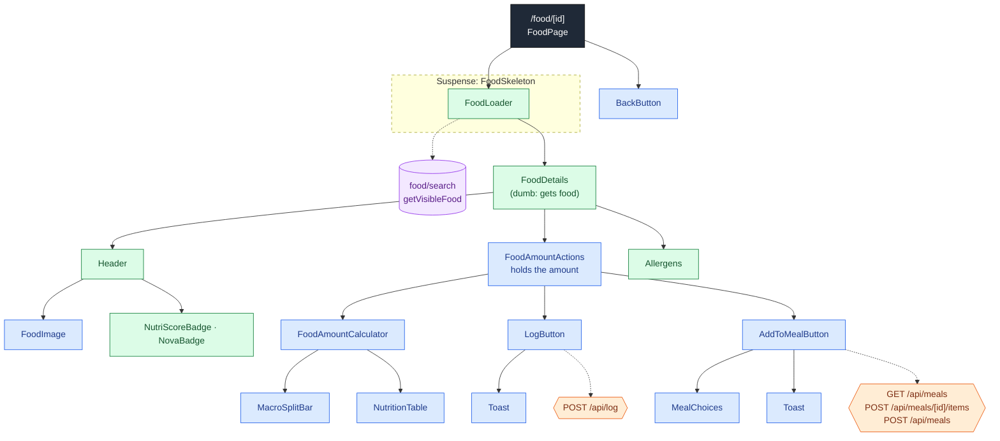

## 6. Custom food

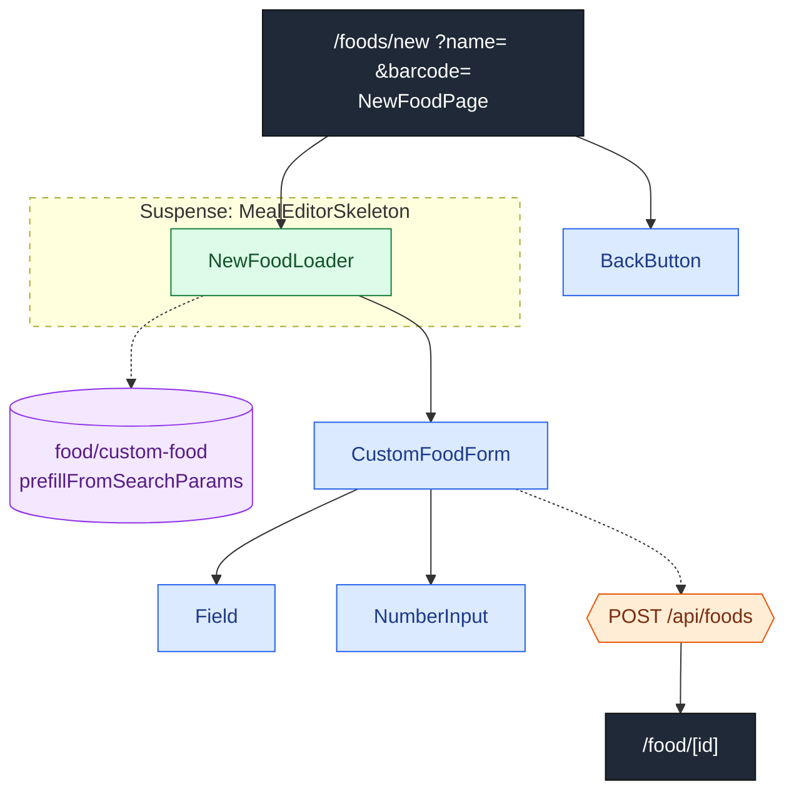

## 7. Meals

### 7a. My meals and public meals

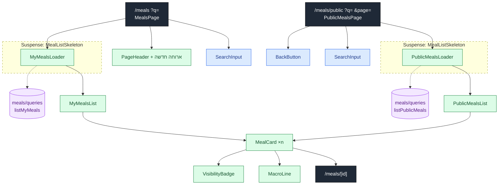

### 7b. One meal: owner edits, others view

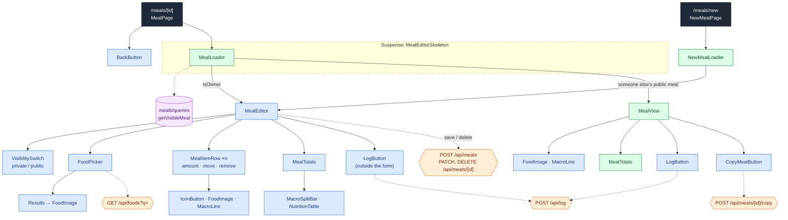

## 8. Stats

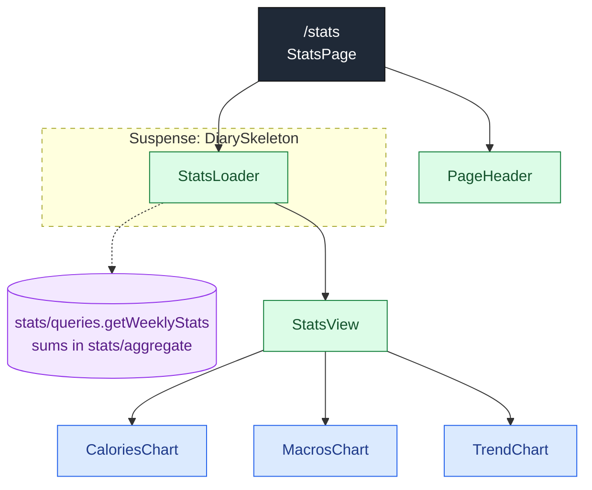

## 9. Settings and goals

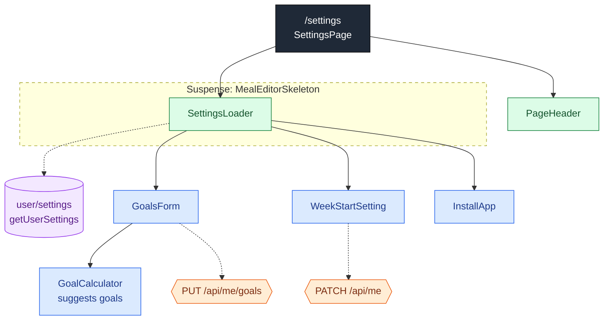

## Data flow (reads and writes)

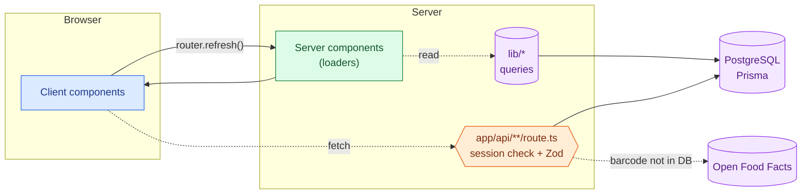
